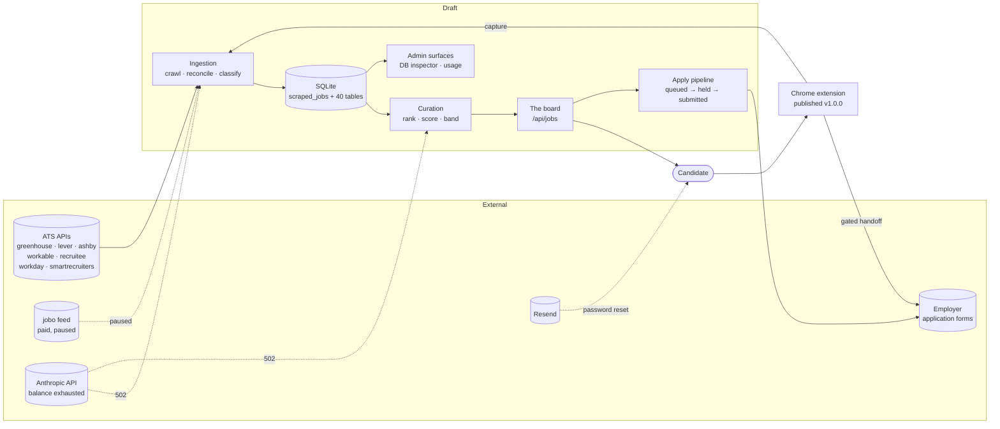
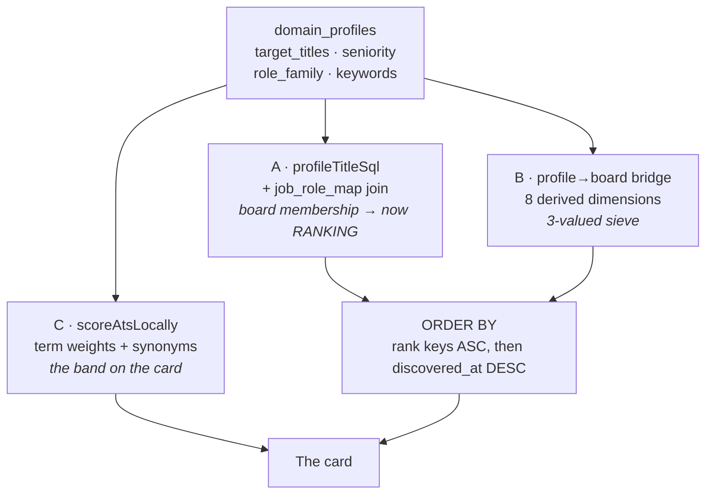
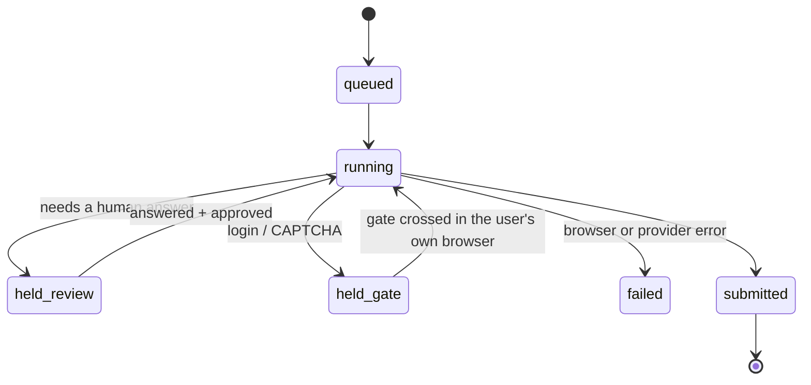
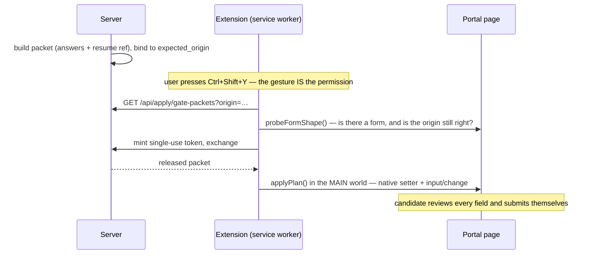
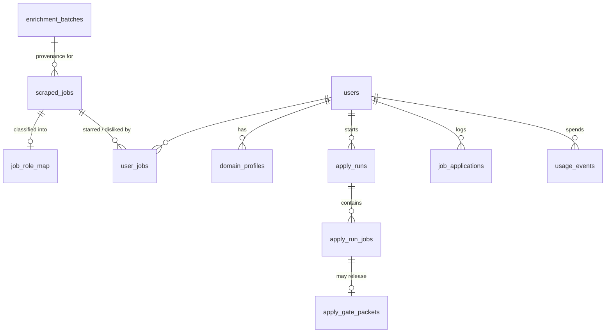

# Architecture

**Written from the code and the running system on 2026-09-24, against commit `4643e20`.** Every
figure below carries how it was measured. Nothing is carried forward from another document —
every number in the docs this replaces had been wrong at least once.

Two databases are referred to throughout and they are **not** interchangeable:

- **production** — the deployed board, measured through `GET /api/admin/db/raw-query` (SELECT-only,
  server-enforced). 2776 rows, 2662 active.
- **local** — `data/resume_master.db`, a snapshot **restored** from an evidence backup and frozen
  at `scraped_at = 2026-09-17`. 2460 rows, **all** active, because a restore never deactivated
  anything. It cannot be used to verify the expiry brake, and its coverage figures are its own.

⛔ **A 200 is not evidence.** `express.static` plus the SPA catch-all answer 200 with `index.html`
for any unknown path. Judge every probe by **response body and content-type**. That mistake has
produced a false finding four times.

---

## 0 · Context



The system crawls applicant-tracking systems directly, reconciles postings into one board, enriches
and scores them against a stored profile, and then either fills an application form or hands the
filled form to the candidate to review and submit. **Every dotted edge above is currently dead:**
the Anthropic balance is exhausted, so enrichment 502s and the jobo feed is paused pending credit.
**Capture is the exception:** since the deterministic fallback landed it degrades rather than
failing, filing the posting from the labelled block the extension already sends — see §10.

---

## 1 · Ingestion

Seven ATS plugins are registered in `services/jobs/aggregator.js`, plus the jobo feed. **Five
produce rows.**

Measured across all 45 production crawl runs in `pipeline_runs`:

| source | runs | fetched | written | unchanged | discarded | discard rate |
|---|---:|---:|---:|---:|---:|---:|
| greenhouse | 45 | 54,521 | 5,071 | 33,225 | 16,225 | **29.8%** |
| ashby | 45 | 42,688 | 2,065 | 27,676 | 12,947 | **30.3%** |
| lever | 45 | 2,920 | 216 | 1,874 | 830 | **28.4%** |
| jobo | 45 | 280 | 134 | 0 | 146 | **52.1%** |
| workable | 45 | 459 | 12 | 91 | 356 | **77.6%** |
| recruitee | 45 | 253 | 8 | 62 | 183 | **72.3%** |
| workday | 45 | **0** | 0 | 0 | 0 | — |
| smartrecruiters | 45 | **0** | 0 | 0 | 0 | — |

⛔ **The discard rate is the largest unexamined number in the system.** Between a quarter and
three-quarters of everything fetched is dropped as unclassifiable before the board sees it —
roughly **30,000 postings** over these 45 runs. Nobody has inspected a sample of what is being
thrown away, so it is not known whether the classifier is correctly rejecting irrelevant work or
silently eating the board's best rows. This is the single cheapest high-value audit available.

`ejected` is a separate and much smaller count (blue-collar postings, deliberately removed).

**The two silent sources.** `workday` and `smartrecruiters` are scheduled and run daily, and every
run reports `status: "skipped_unconfigured"` with 0 fetched. They have therefore never contributed
a row. ⛔ **The boot log disagrees with the crawl:** `[JobAggregator] Active sources:` lists both,
because `isConfigured()` returns true at startup while the crawl reports them unconfigured. Two
notions of "configured" that do not meet — defect shape 1, in the place most likely to mislead
whoever next asks why the board is thin. *Owner 2026-09-24: could be both a config gap and a
wiring defect; not yet separated.*

**jobo** is a paid feed. Its credit expired and it is **deliberately paused** while testing
continues on free sources. *Owner confirmed 2026-09-24.* Its last run reports `failed`; that is the
paused state, not a regression.

**Reconciliation.** `reconcileFingerprint()` and `computeReqUid()` collapse the same posting seen
through different sources into one canonical row, under the priority **direct ATS > provider >
aggregator > import**. A row arriving from a lower tier merges into the canonical one rather than
duplicating it; `merged` in the table above counts those.

**Freshness.** Each source carries a watermark advanced only after a successful fetch *and* upsert,
so a failed crawl re-reads rather than skipping a window. Rows are pruned to `is_active = 0` by two
independent paths — expiry (`valid_through` passed) and staleness — reported separately in the run
record. Production holds 114 inactive rows; **the local snapshot holds none**, which is why the
brake cannot be verified locally.

---

## 2 · Enrichment

`enrichJob` selects candidates on `enriched_at IS NULL OR content_hash IS NULL OR updated_at >
enriched_at`, then **re-filters in JS on the exact content hash**. The SQL pre-filter alone is not a
cost basis: on the restored local board it matches 1252 rows where the hash check leaves 5, a 250×
over-count, because the restore stamped one bulk `updated_at` onto rows whose text never changed.

**It has been dead since 2026-09-17.** The most recent production run:

```
run_kind=enrichment  status=failed  fetched=25  written=0  failed=25
stopReason="no_progress"  remainingCandidates=1661
budget={maxRows:300, maxUsd:1, maxMinutes:20}
```

Every failure is the same 400 from Anthropic: *"Your credit balance is too low."* Re-probed free
on 2026-09-24 with `max_tokens:1` — still exhausted.

**Which columns actually come from enrichment.** This is the measurement that matters, and it
overturns the common assumption that enrichment fills the board:

| column | production | local | source |
|---|---:|---:|---|
| `normalized_title` | 100.0% | 100.0% | **ingestion** |
| `experience_level` | 100.0% | 100.0% | **ingestion** |
| `summary` | 99.9% | 99.9% | **ingestion** |
| `skills_json` | **41.0%** | **35.8%** | **enrichment — the only real gain** |
| `workplace_type` | 43.4% | 45.2% | mixed |
| `salary_min_usd` | 49.9% | 49.4% | mixed |
| `org_unit_raw` | 32.1% | 31.6% | mixed |
| `is_h1b_sponsor` | 0.3% | 0.1% | enrichment |

⛔ **`skills_json` is 41.0% in production and 35.8% locally.** Earlier docs claimed 99.8%; the
correction register then said 43.7%. Neither holds. Measure it, do not quote it.

**1559 production rows have never been enriched** — the unambiguous backlog. At Haiku list price
the whole backlog is roughly **$5.68**, so cost is not what is blocking it.

⛔ **Rewrites are invisible.** `columnsClimbed` counts only NULL→value transitions, so a value
*corrected in place* is reported as nothing at all — enrichment has been editing already-populated
fields while reporting only its fills. A prior audit put this at roughly 19–25 values per 10 rows,
mostly `summary` and `normalized_title`. ⚠ **That rate was NOT re-measured on 2026-09-24** and
cannot be while the balance is exhausted; treat it as the last known figure, not a current one.
What is certain from the code is the structural point: the counter cannot see a rewrite.
**Nobody has judged whether the rewrites are improvements.**

Writes follow two rules that exist because both were once violated: **COALESCE**, so a model
returning nothing cannot blank a good value, and **don't stamp on empty**, so a row that gained
nothing stays a candidate instead of being marked complete.

---

## 3 · Curation and scoring ⛔ the most important section

**Three systems decide one question — "is this job a good match?" — and they do not agree.**



**The board does rank — and it still does not rank by fit.** Both halves are true and the
distinction is the whole section.

It ranks: `buildOrderKeys()` prefixes the default sort with the derived rank keys, and
`appliedDerivedKeys` unconditionally includes `role_key` on any non-Saved board, plus
`target_title_exact` and `target_title_role` whenever the profile has target titles — which all 8
production profiles do (122–303 characters each). The client's initial sort is `dateDesc`, so the
prefix applies.

It does not rank by fit: each key is **three-valued** (`MATCH=0`, `UNKNOWN=1`, `MISS=2`), so the
result is a coarse sieve, not a score. **Measured: 700 active production rows tie at `MATCH` on
`role_key` alone** for an engineering profile, out of 2662. Within a tie the order is
`discovered_at DESC`. So what a candidate actually sees at the top of the board is *recency inside
a 700-deep band*. ⛔ And **any explicit sort removes ranking entirely** — choosing "Pay high to
low" drops the prefix, by design: a user instruction about order wins outright.

**Derived keys rank; they never exclude.** A value the *user* set filters rows out; a value derived
on their behalf only moves rows down, and `rank.demotedSql` counts how many were pushed down so the
UI can disclose it. That rule is structural — `appliedDerivedKeys` is carried into the query builder
rather than re-inferred, because the merged filter object looks identical either way.

**Agreement between the three, and what ρ supports.** The test suite asserts **ρ = 0.746** against
the owner's 30 human-graded postings, with **12.2% of pairs still mis-ordered**.
`CORRECTIONS_REGISTER.md` records a later reproduction at **ρ = 0.737**, and — more importantly —
that **26 of the 30 postings now score differently from the human key, max |delta| 40**. *Owner
2026-09-24: document both figures and the drift.* The drift is the finding: the corpus is the only
ground truth here and the engine has moved away from it while the headline ρ barely changed.

⛔ **What ρ ≈ 0.75 does not support** is ranking thousands of rows. It supports "the top of a short
list is roughly right". A full board implies exhaustiveness and invites judgement of ordering
across 2662 rows, which this correlation cannot carry.

**The graded corpus is irreplaceable.** `docs/am1-ats-graded-corpus.json` holds the 30 grades; the
original postings behind them were destroyed in the id-85 deletion. It cannot be rebuilt.

**`scraped_jobs.ats_score` is NULL on every row in both databases.** *Owner confirmed 2026-09-24:
by design.* CC5 made scoring per `(user_id, domain_profile_id, job_id)`, so a single global column
on a shared row cannot be correct. It is vestigial and scoring happens per request. See §9.

**Term weights.** Production carries 493 terms computed `2026-09-18 22:34` (local has 604 — a
different corpus). Refresh is due at 14 days, **2026-10-02**; scoring silently reverts to unweighted
with a `console.warn` at 45 days, **2026-11-02**. Earlier docs said 2026-10-13, which was correct
for the previous computation and is now stale.

---

## 4 · The apply pipeline



⛔ **Nothing has ever reached `submitted`.** Measured in production: **9 `apply_run_jobs` rows —
7 `held_review`, 1 `held_gate`, 1 `failed`, 0 `submitted`** — and **0 rows carry any submit
evidence** (`submit_verified` and `submit_evidence` are NULL on every row). Reason codes seen:
`resume_required` ×2, `manual_review` ×2, `captcha_required` ×2, `browser_error`,
`incomplete_form`, `provider_review_only`.

Earlier documents say "the pipeline has completed one real application". **That is wrong.** The
five `job_applications` rows are unrelated to the pipeline: four are `apply_mode: CUSTOM_SAMPLER`,
`source: LinkedIn`, logged in April 2026; one is `apply_mode: MANUAL`. None carries an
`auto_status` indicating an automated submission. *Owner 2026-09-24: recorded as measured; the
discrepancy was not previously known.*

⛔ **`apply_runs.status` carries two spellings** — `complete` (3 rows, April) and `completed`
(6 rows, August). A filter written against either silently misses the other set. *Owner 2026-09-24:
not previously known; recorded as a defect.* Chronological, so the newer spelling is presumably
canonical, but nothing enforces it.

**The integrity rules are architecture, not policy.** They are load-bearing and two of them exist
because they were violated in production:

- **No model call in the answer path.** Answers are resolved deterministically or not at all.
- **Flag, don't fabricate.** A field that cannot be resolved is reported, never guessed.
- **Eligibility fields resolve by exact handler mapping or not at all.** Work authorisation,
  sponsorship, clearance, visa, EEO and criminal history are attestations to an employer. Two live
  defects came from label matching getting clever near them: `login_email` matched the email
  handler and typed a home address into a sign-in box at 0.9 confidence, and a `work_authorization`
  key substring-matched a semantically **inverted** sponsorship question.
- **The company KB learns only from company-emitted data**, and holds companies and roles only —
  never individuals. ⚠ This one is recorded from the design brief and **was not verified against
  the code on 2026-09-24**; the other three were. Verify before relying on it.

⛔ **`semi` mode does not HOLD on the completeness or low-confidence gates** — both live inside
`if (isUnattended)`, so the human is the only thing that blocks a submission. That is a deliberate
product decision: semi's premise is that a person is looking at the form, so holding would defeat
the mode.

What it does do, since AE6: semi runs **the same discovery pass the gate uses, without the hold**,
and returns `missingRequired` and `openQuestions` in the shape the unattended hold emits. Before
that it performed no check at all and the review surface rendered a clean row over a form that
could not be submitted — *"not 'the gates are off in semi', which is defensible; the run declining
to report a fact it already had in hand"* (`services/applyAutomation.js`). Do not restate this as
"semi runs no gates"; the distinction is between not blocking and not reporting.

A semi run's audit row is still written **before** the human's edits happen, so it records what the
machine produced, not what was submitted.

---

## 5 · The gated handoff and the extension

**Why it exists:** some applications sit behind a login or CAPTCHA the server may not cross. The
candidate's own browser already holds that authenticated session. The extension borrows it for one
gesture, under `activeTab`, and fills the form the server prepared.



**The order is the security design.** Origin read → packet located by origin → form confirmed
present → *only then* is a token minted and spent. Every refusal happens before a token exists, so
a mismatch costs nothing. The packet is single-use and expires; a tab that closes clears it.

`applyPlan` writes through the prototype's **native setter** and then dispatches `input` and
`change`, because these portals track an input's value on the node itself and a plain assignment
leaves the framework believing nothing changed. The résumé is attached through a `DataTransfer` on
a real `input[type=file]` — and the attachment is confirmed by reading the page's own `files[0]`,
not by assuming the property took.

**The auth model, as fixed 2026-09-24.** The extension previously authenticated with
`credentials: 'include'` — the ambient browser cookie — so it acted as whatever session the browser
held. A measured probe from the extension origin reached **7 of 7 admin routes with real admin
JSON**. It now bootstraps `GET /api/auth/extension-token` once and sends only that token, with
`credentials: 'omit'` everywhere else; the server refuses admin routes to the extension regardless.
The popup names the identity it holds. Full account: `docs/EXTENSION_DIAGNOSIS.md` §6.

⛔ **There is no mobile analogue and there cannot be one.** The handoff depends on running inside
the browser that holds the portal session. This is the constraint that shapes both mobile apps: a
phone can review and queue, but the gate crossing has to happen somewhere a browser extension can
reach.

**Still open** (`docs/EXTENSION_DIAGNOSIS.md`): dead routes `/resume` and `/ats-score`, a
non-retryable billing error worded as retryable, and no read-back verification after a field is
filled.

---

## 6 · Data model



| table | production rows | what it is |
|---|---:|---|
| `scraped_jobs` | 2776 (2662 active) | the global posting pool; **shared**, not per-user |
| `job_role_map` | 2782 | role classification; the board's join. ~6 orphans |
| `user_jobs` | 17 | per-user star / dislike / applied |
| `domain_profiles` | 8 | the profile the board ranks against |
| `apply_runs` / `apply_run_jobs` | 9 / 9 | the pipeline's state machine |
| `job_applications` | 5 | **manual** application log — not the pipeline |
| `usage_events` | 1971 | every model call, success or failure |
| `enrichment_batches` | 46 | batch provenance, enabling revert |
| `skill_synonyms` | 218 | 196 proposed, 12 confirmed, 10 rejected |
| `ats_term_weights` | 493 | corpus-derived scoring weights |

**`scraped_jobs` is shared across users.** Anything user-specific belongs in `user_jobs` or a
profile-scoped table — which is exactly why the global `ats_score` column is vestigial (§3).

**Migrations are additive-only, dual-path and transactional.** The same list exists in
`scripts/migrations.js` and in `server.js`'s `MIGRATIONS` array, and tests assert the blocks are
**byte-identical** between them. ⛔ `server.js` is the runner that actually executes in production —
a migration added only to `scripts/migrations.js` never runs. Each migration and its bookkeeping row
commit in **one transaction**, so a half-applied migration cannot be recorded as done.

Both runners define **262** numbered migrations (the newest is `269_posting_input_hashes`, 11-10 46d — A176: the kept posting input hashes and their three triggers; before it `268_scraped_jobs_board_cover`, 11-10 46d — A175: the board's covering index; before it `267_billing_and_verification`, 11-10 46b — A167 phase 1: billing, the trial's drafts, OTP codes, signup refusals, the verified phone, the lead-sharing consent, all behind OFF switches; before it `266_resume_filled_fields`, 11-09 45s — D186: the résumé-filled fields and the four things skipped; before it `265_posting_archive`, 11-09 45s — D151 Rule 4: the nightly archive of closed postings, behind its switch; before it `264_atlas_league`, 11-09 45s — A154 / D172 (4): the league and challenges, behind their switches; before it `263_network_feed`, 11-09 45r — D180 P3: the feed, behind the network switch; before it `262_public_open_jobs`, 11-09 45r — A158: the open public board as a narrow trigger-kept table; before it `261_bg_jobs`, 11-09 45q — D151 Rule 2: one background job system; before it `260_user_credit_draft`, 11-09 45q — D185-7: the person's choice to answer How did you hear about us with draft; before it `259_atlas_backlog`, 11-09 45q — D185-3: the Atlas content backlog's draft outlines; before it `258_match_alerts`, 11-09 45q — D185-2: new-match alerts, the settings and one row per job alerted; before it `257_posting_application_schemas`, 11-09 45q — D185-1: the application-schema reader's per-posting cache; before it `256_job_profile_apply_pause`, 11-08 45o: (B)-3 a family change pauses Apply for me; before it `255_job_profile_placement`, (B)-1 the résumé's placement on the job profile; before it `254_run_job_resume_missing_reason`, (A)-1 why a run job has no résumé; before it `253_network_messages`, D180 P2 sealed messages, requests, reports behind the network switch; before it `252_network_connections`, D180 P1 connections + blocks; before it `251_atlas_prefs`, Atlas's weekdays-only streak choice; before it `250_people_index`, 11-08 45n: people search — public pages only; before it `249_company_guides`, 11-08 45n: D150 T12 — company guides from consented debriefs, k ≥ 3; before it `248_market_weeks`, 11-08 45n: D150 T09 — the weekly market snapshot; before it `247_model_source`, 11-08 45n: D162 G6 — the stored résumés' source tag; before it `246_daily_reminders`, 11-08 45m: D154 P1 — the daily question's reminder, off by default; before it `245_profile_public_page`, 11-08 45m: D183 P3 — the report queue; a proof-page user starts Public for projects + skills; before it `244_profile_replacements`, 11-08 45m: D183 P2 — a résumé replace re-fills, says what changed, Undo 30 days; before it `243_profile_page`, 11-08 45m: D183 P1 — Profile = your page, who can see it, hand-added achievements; before it `242_daily_question_response`, 11-08 45l: D154 P2 — a match / order answer's response; before it `241_atlas_taxonomy_roles`, 11-08 45l: D179 P6 — the roles as drafts; before it `240_daily_questions`, 11-08 45l: D154 P1 — the daily question; before it `239_audit_sessions`, 11-08 45l: D150 T05–T07 — the audit; before it `238_company_web_signals`, 11-08 45l: D179 P5c — website signals; before it `237_company_follows`, 11-08 45l: D159 T1 — Follow a company; before it `236_company_github`, 11-08 45l: D179 P5b — public GitHub languages; before it `235_company_facts`, 11-08 45l: D179 P4b — public facts for the company page; before it `234_a140_trial_cleaned`, 11-08 45l: A140 — trial accounts cleaned once; before it `233_job_taxonomy`, 11-08 45l: D179 P2 — category → subcategory per posting; before it `232_company_tech`, 11-08 45l: D179 P5a — technographics from postings; before it `231_company_records`, 11-08 45l: D179 P4a — one company = one record; before it `230_atlas_edges_changes`, 11-08 45l: D151 — triggers on `atlas_edges` move `atlas_changes`; before it `229_scraped_jobs_active_recency`, 11-08: D151 Rule 4 — the board's recency as a partial index, so "being matched" stops at 2,001 rows; before it `228_job_captures_user_job`, 11-08: D151 Rule 4 — the index the board's capture EXISTS lacked; before it `227_proof_page_learning`, 11-08: D178-4 — `proof_pages.show_learning`, the proof page's Atlas section, OFF until the person ticks it; before it `226_proof_points`, 11-07: D172 (3) — `proof_points`, one row per piece of proof (an idea explained in your own words, a build, a skill checked or built), keyed (user, kind, ref) so proof never pays twice; before it `225_posting_description_snapshot`, 11-07: D171 FIX 3 — `apply_run_jobs.posting_description`, the JD as stored when the application was queued; before it `224_started_by_and_key_label`, D171 FIX 1 + FIX 2 — who started each run and model call, which key paid, `users.test_account`; before it `223_your_skills` (after `222_saved_answer_scopes`, D165 (3)), 11-06: D169 — `skill_proofs`, `skill_quick_checks` and `atlas_skill_holds`, Your skills in Atlas and the proof gate before a skill reaches a tailored résumé (services/yourSkills.js); before it `221_model_gateway`, 11-05: D162 G3 + G4 — `usage_events.task` / `route` and `model_eval_records`, the model gateway's telemetry columns and per-task evaluation records (shared/modelTasks.js, services/modelGateway.js, services/modelEvals.js); before it `220_users_deck_size`, 11-05: D152 (3) — `users.deck_size`, the deck's picks per day; before it `219_boot_bounded_scans`, 11-04: A123 (2) — the trigger that clears a changed description's basis, so the boot's stale scan reads an index; before it `218_learn_questions`, 11-04: D150 T01 — the one question bank, drafts until reviewed, and its answers; before it `217_readiness`, 11-02: D142 — readiness CHECK; before it `216_warm_contacts`, 11-02: D138 — the user's own contacts for warm paths; before it `215_navigator`, 11-02: D143 — the navigator's aim, route and changes; before it `214_application_signals`, 11-02: D136 P3 — the signals each application had when sent; before it `213_ghost_score`, 11-02: D137 — the ghost score and its evidence; before it `212_tailoring_choice`, 11-02: D123 — the person's tailoring model, the per-employer gists of a base résumé, their coursework; before it `211_ats_gold`, 11-01: D125 — the owner's ATS calibration, a frozen gold set, his reviews and the regression gate's baselines; before it `210_trial_demo_tailoring`, 11-01: the trial's demonstration — a sample's tailored résumé per posting, simulated, made once and replayed for every tester on that sample; before it `209_standalone_surveys`, D130, 11-01: the standalone survey's responses — name, email, answers, one row per lower-cased email; before it `208_lca_employer_name_index`, 43y fix, 11-01: an index on `lca_employer_periods.employer_name` — D121's per-row sponsorship lookup scanned 481,588 rows, 2.5 s a row, and froze the deck's deal; before it `207_posting_category`, D126 + D127, 11-01: every posting in ONE professional category — `scraped_jobs.board_category` (the older `category` column is unwritten), `soc`, `discipline`, `category_confidence`, `category_reason`; 'held' is never shown on any board; services/jobs/professionalScope.js decides, boardScope's gate and a boot backfill write it; before it `206_scrub_apify_tokens`, A108, 11-01: Apify scrapped, the stored tokens cleared; before it `205_trial`, D124, 11-01: the trial as the main frame (access, events, survey, practice form); before it `204_resource_thumbs`, D119, 11-01: the stored thumbnails; before it `203_lca_employer_titles`, D121; before them `202_learn_circle`, D117, 10-31: Learn as a circle — `learn_needs` (each piece's "Before this" links with a status: drafted until the owner's review accepts or rejects them; a re-import never moves one), `learn_teaches` (the concept terms a piece teaches, resolved to Atlas nodes on read through the one resolver — D116 M8's unlock link), `learn_extra_items` (D115 P5's optional games / exercises / practice links, 'pending' until the dead-link checker passes them, 'held' when dead), `learn_routes` (guided routes as data; four seeded) and C8's earned progress — `learn_opened` (an item opened from draft), `learn_explanations` (a checkpoint explained in the user's own words, private, never read by a model) and `learn_builds` (a link to what was built); learn_progress (195) is kept and no longer counts; services/learn/learnCircle.js, learnEarned.js. Before it, `201_atlas_node_family`, D116 M1, 10-31: `atlas_nodes.family` and `family_by` — a node's family on Your map's tree, seeded once from content/atlas/families.json (only where family_by is NULL) and set or cleared by a curator in Admin → Atlas, which sticks; no CHECK, so a family can be added without a rebuild; services/atlas/atlasFamilies.js. Before it, `200_draft_house_leftovers`, D113 UI, 10-31: the Draft House tree's leftovers — `interview_prep.time_zone` and `interview_at` (Add the date; D110's interview_prep stays the one store of the date) and `job_applications.rejection_note` / `rejection_reasons` (Note why, private; never read by a model); no new table. Before it, `199_atlas_live_counts`, D118 P1, 10-31: the Atlas counts move with the board — each active posting's reading by the one matcher (atlas_posting_match), per role × level counts (atlas_role_level_stats), the store's state (atlas_live_state) and a queue filled by TRIGGERS on scraped_jobs (atlas_posting_dirty), so no write path is missed; services/atlas/atlasLive.js. Before it, `198_learn_content`, D118 P2, 10-31: the Learn content in the database, one validated JSON document per source, replaced by Admin → Atlas → Import content and seeded from content/learn/*.json only while the table is empty; 196 and 197 are held by parallel lanes. Before it, `195_learn_progress`, D115 P3, 10-31: a learner's marks on the owner's tracker, one row per (user, item or checkpoint). Before it, `194_atlas_concept_pattern_kinds`, D115, 10-31: atlas_nodes REBUILT to admit the `concept` and `pattern` kinds, run with `foreignKeys: "off"` (scripts/applyMigrations.js — with foreign keys on, the rebuild's DROP cascades) and backed up first; 180 and 185 unused. Since 174: `175_job_history` D107 · `176_level_read` D106 · `177_atlas` D105 · `178_what_changed` D108 · `179_education_source` · `181_gmail_connection` · `182_portal_reset_existing` · `183_web_push` · `184_proof_links` D109 · `186_interview_mode` D110 · `187_sponsorship_facts` D108 · `188_picks` D113 · `189_atlas_publish` D105 P7–P9 · `190_atlas_wiki_match` · `191_atlas_wiki_match_backfill` · `192_atlas_definition_draft` D105 P11 · `193_atlas_link_counts` D114. Before them, 174 — `174_inbox`, D103, 10-30: the inbox on a forwarded copy of the user's own mail — `inbox_addresses`, `inbox_messages` (text only, sorted by rule, matched to an application), `inbox_corrections`, `inbox_code_optins` and `inbox_code_uses` — services/inbox.js, routes/inbox.js; before it `173_structured_profile`, D101, 10-30: the profile in sections — summary, experience, education, skills, links — filled from the base résumé's parse on first open and offered after a new upload, never rewriting the uploaded file, and `application_defaults`, which holds only what the user set (an absent row is not set) — services/structuredProfile.js; before it `172_portal_accounts`, D100 (a), 10-30: `portal_accounts`, an account the apply worker creates for the user on a portal — the user's own email, a password the worker generates and seals so draft holds ciphertext only, consent per portal — and `apply_remote_runs.account_id`; before it `171_apply_worker`, D100 P2, 10-30: the apply worker's data — `portal_sessions` (sealed portal sessions, ciphertext only, a per-session key the worker minted and destroys on revoke), `portal_session_uses` (the use log) and `apply_remote_runs` (the worker's queue, leased over the signed /api/worker API) — services/applyWorker.js, routes/applyWorker.js; before it `170_auto_settings`, D102 P4 / D100 P7, 10-30: `users.auto_settings`, the FULL AUTO standing instruction as validated JSON (shared/autoSettings.js), and `users.auto_last_run_at`, when the FULL AUTO scheduler last ran for the user (services/autoScheduler.js); before it `169_send_mode_submitted_by`, D100, 10-30: gates lifted — `users.send_mode`, FULL AUTO as the user's own mode (NULL = SEMI) in place of the removed `FULL_AUTO_PROVEN` constant, and `apply_run_jobs.submitted_by`, whose submit it was ('user' approved · 'auto' the user's standing instruction) — routes/apply.js; before it `168_extension_intent_settings`, the field report 10-15 (T24): `users.extension_intent`, the intent model's two settings and the remembered answer to its one question, kept with the account — routes/extensionDraft.js; before it `167_extension_resume_cause`, the field report 10-14 (T6): `extension_resume_generations.cause`, why a generation failed as "<stage>:<code>" — a code, never a message — shown in the extension's Show details view, never in the user's sentence; before it `166_resume_pdf_artifacts`, D98 P1 (lane J3), 10-13: `resume_pdf_artifacts`, the PDF the extension attaches, KEPT as a BLOB with its sha256 (the one path where D16's "never store a PDF" is reversed, so What we sent shows the exact file), linked to its generation, its job and — once the application is recorded — its record and HTML snapshot; services/resumePdfArtifacts.js; before it, 165 — `165_extension_resume_generations`, D98 P1, 10-13: one row per on-page résumé request (job, base-résumé hash, status queued · generating · ready · refused · failed · cancelled, the Draft slot it spent and its refund, the version and score pair, the guard's result), once per job and base by a partial unique index — services/extensionResume.js, routes/extensionResume.js; before it, 164 — `164_saved_answer_lifecycle`, D96 §4 (lane J8), 10-13: the saved-answer lifecycle — `saved_answers` (an answer the on-page panel acknowledged, keyed by the normalised label + widget kind + option wording, with its state `acknowledged` · `changed`, source `you_typed` · `you_acknowledged` · `legacy`, date acknowledged and last reviewed), `answer_history` (every change: from → to · when · which job) and two `user_profile` columns — `custom_answers_acknowledged_at` (the existing label-only answers, marked acknowledged at migration time) and `answer_review_reminded_at` (the 90-day review reminder shown once in the panel); additive, both cascade with the account — services/answerLifecycle.js, shared/answerKey.js; before it, 163 — `163_delete_former_admin_row`, D95, 10-13: the suspended former admin row deleted on the owner's word, its blocking reference cleared and the delete audited; before it, 162 — `162_no_admin_in_users`, D95 Phase 2, 10-13: the former admin row loses its credentials, is suspended and audited, `is_admin` is cleared, and two triggers make the database refuse an admin flag on any users row; server.js takes a backup first; before it, 161 — `161_job_page_keys`, extension v1.5.2, 10-13: a page's job key (a Workday requisition, services/jobPageKey.js) → the board job a capture folded it into, so every stage of one application resolves to one job; before it, 160 — `160_user_tags`, the D86/D88 follow-up's item 3, 10-12: `user_tags`, an admin's internal / test / beta mark on a user account — People → Users shows every account and its filter hides internal and test ones, saying how many — services/userAdmin.js; before it, 159 — `159_admin_accounts`, D95 Phase 1, 10-12: admin identities apart from users — `admin_accounts` (`adm_…`), `admin_sessions` (`dft_adm_…`, the `draft_admin` cookie scoped to `/api/admin`), `admin_sign_in_links` (`dft_adml_…`), and a coded actor on every admin-side write (`admin_audit_log.actor_kind` / `actor`, `*_actor` columns) — services/adminAccounts.js, services/adminGuard.js, services/actor.js, routes/adminAuth.js; before it, 158 — `158_email_events`, D94, 10-12: `email_events` (each verified Resend webhook event of a handled type, keyed by its Svix id so a retry is recorded once; type, time, email_id and the provider's reason — never the recipient; deleted after 90 days) and `email_domain_status` (the sending domain's last reported verification) — services/emailHealth.js; before it, 157 — `157_base_resume_uploads`, D90 P1, 10-10: every distinct base résumé the user uploads is kept in `base_resume_uploads` and each `resume_versions` row records its `base_upload_id`; before it, 156 — `156_support_tickets`, D88 P3, 10-09: `tickets` and `ticket_messages`, cascading from the account, an internal note marked `internal` and never read for the user — services/tickets.js and routes/tickets.js; before it `155_user_management`, D88 P2, 10-09: an account's status (suspend with a reason), `admin_audit_log.reason`, `user_entitlement_overrides` (per-user values with a reason and an expiry, read first by services/entitlementResolver.js) and `user_notes` — services/userAdmin.js and routes/adminPeople.js; before it `154_email_consent`, D73 §B, 10-09: marketing consent on `users`, the `email_suppressions` list and the `notice_log`; before it `153_auth_context_auth_at`, sessions A′, 10-09: each browser token's own sign-in time, read by the step-up check for the acting identity; before it `152_byom_oauth`, D86, 10-08: bring-your-own-model résumés — the OAuth 2.1 tables (`oauth_clients`, `oauth_connections`, `oauth_codes`, `oauth_tokens`; hashes, never values), `byom_briefs`, `mcp_audit` and `users.byom_enabled` — services/byom/ and routes/byom.js; before it `151_enrichment_provenance`, D84 F2, 10-09: `scraped_jobs.enrichment_provenance`, a JSON map from each enrichment column to where its value came from — `crawler_fallback` (a guess, which counts as empty for the importer's fill-empty-only), `source`, `board_location`, `import`, `owner` — written on insert by the crawl and by every import, and backfilled at boot by detection; before it `150_description_full`, D84 F1, 10-09: `scraped_jobs.description_full`, the posting's whole text beside the capped `description` (which keeps its hash), read by the enrichment export so it never cuts the middle, and `enrichment_partial`, a row filled from cut text, back in the backlog; before it `149_board_visit`, D74 P1, 10-08: two `users` columns, the board-visit stamps *since your last visit* reads; before it `148_company_candidates`, D82, 10-08: `company_candidates`, the candidate pool the discovery jobs write and the nightly read-only probe annotates (adding stays the owner's approval), and `discovery_breakers`, the per-source circuit breaker; before it `147_company_evidence`, D80, 10-08: `company_ats_list.evidence`, the stored reason each company is configured; before it `146_board_policy`, D78, 10-07: the board's age limit and the two enforcement switches; before it `145_crawler_worker_seen`, D75 STEP 1c, 10-07: "worker last seen" on `crawler_state`; before it `144_crawler_controls`, D75 STEP 0b, 10-07: the crawler's controls in the database — `crawler_state` (Pause, mode, cap, schedule; starts paused and dry) and `crawler_tasks.mode` / `source` / `flagged_wrong`; before it `143_deploy_events`, D76, 10-07: Railway's webhook events, written only by `POST /api/hooks/railway` — header-authenticated, ids only, read-only; before it `142_crawler_worker`, D75, 10-07: the crawler worker's queue `crawler_tasks`, the owner-editable `crawler_denylist`, and two observation columns on `apply_origin_pairs` — docs/CRAWLER_WORKER.md; before it `141_pay_from_text`, D71, 10-07: `pay_text_min_usd` / `pay_text_max_usd` on scraped_jobs, the pay a posting states in its own text as a USD-per-year estimate for the sort and the salary filter, written by the description pass and never into `salary_*`; before it `140_apply_origin_pairs`, D67 (2), 10-07: the self-learning origin table — `apply_origin_pairs` (two hostnames and a count, shared, no identity) and `apply_origin_sightings` (pair × user, to count distinct users; promoted at 3, revocable by an admin); before it `139_base_resume_only`, D66, 10-07: `users.base_resume_only`, the switch that sends the base résumé with every application and calls no model for it; before it `138_resume_parse`, D65, 10-07: the parse of a résumé stored with it — `resumes.parsed_json` / `parsed_basis` and the same on `profile_base_resumes` and `base_resume` — so a packet's work history and skills come from the résumé it carries, re-parsed only when that résumé's text changes; before it `137_description_text`, D59, 10-07: postings that arrive as raw HTML and label blocks — the normalised text in `scraped_jobs.description_text` (NULL when it equals `description`), the label block's fields in `description_fields`, the posting's stated citizenship / clearance in `req_citizenship` / `req_clearance` / `req_clearance_status` / `req_polygraph`, each served only while `description_basis` matches the description it was read from (no trigger); `description` and `content_hash` are never rewritten; before it `136_form_reports`, D55 decision E, 10-07: the extension's "Report this form", `form_reports` — the form page's host and its field labels, never a value, linked to the reporter and purged after 30 days; 132–134 unused; before it `135_application_company_domain`, D55 (i), 10-07: The Table's CSV import keeps each imported application's company website, `job_applications.company_domain`, so the D54 company key stays honest for rows with no posting; 132–134 unused on this branch; before it `131_resume_score_pair`, D58, 10-07: the base → tailored pair kept with a generated résumé, `resumes.base_ats_score` / `resume_versions.base_ats_score`; before it `130_draft_bin`, D53, 10-07: Draft House's 7-day bin, `apply_run_jobs.purge_after` / `purged_at`; `125_application_artifacts` (D16) and `126_ats_grade_corpus` (A76) sit before 127 in both lists and, because the runner applies by id rather than by number, still run on a database already at 128 — test/lateLowerMigrations.test.js holds that). Production had applied **125** on 10-02 (`/api/version`, commit `bfef596`): the
first **119** of them (117 is unused), plus **6** unnumbered legacy ids predating the `NNN_` convention (`admin_cache_events`,
`admin_scrape_events`, `admin_usage_events`, `admin_user_limits`, `ats_only_reports`,
`contact_messages`). Defined high-water: `129_application_snapshots` (D43 — an application record survives its posting: `job_applications` keeps the pay it was posted with, `apply_run_jobs` keeps the posting's title, company, URL and location), after `128_job_tags` (D29 — the board's own filter tags: level, function, employment type, workplace and a remote flag as `scraped_jobs.tag_*`, and each posting's places as a set in `job_tag_places`; derived deterministically, owner-filled by export → import, NULL = unknown), after `127_slug_harvest` (D20 — the slug harvest in the daily manual sweep: SerpApi searches started by a person pool ATS boards we do not crawl, as an unordered set never tied to the job they were found under; the owner reviews an export and imports decisions, revertable whole), after `126_ats_grade_corpus` (A76 under D17 — the validation corpus graded outside the product: `ats_corpus_grades`, and `enrichment_batches.kind` so a grade import reuses the enrichment batch provenance and revert; merged 10-05, after 127/128 had been applied in production), after `125_application_artifacts` (D16 — the résumé an application sent, brotli-compressed HTML with its sha256, kept with its application record and downloaded from The Table; merged 10-05, after 127/128 had been applied in production), after `124_company_logos` (A77 — each company's logo resolved once during enrichment
and stored as bytes, served from `/api/company-logo/<key>`), after `123_owner_skill_aliases` (A72 — the owner's two confirmed skill aliases, ai ≡ artificial
intelligence and ml ≡ machine learning, which the board's ranked search and the scorer both read), after `122_job_captures` (A62 — every job a user brings in or an admin imports goes through
one gateway, `services/jobs/jobGateway.js`; `job_captures` records it with the ATS host + slug, `job_import_batches` makes
an admin import revertible), after `121_application_records` (A63 — `application_records`, a job is
Pending until a recorded submission VERIFIES and only then written to `job_applications`; `draft_slot_uses`, the ledger
of board résumé generations that share the day's Draft slots), after `120_apply_run_line` (A59 — `apply_runs.line_position`: a Draft made while a
run is active waits in line as status `waiting` instead of being refused 429), after `119_admin_audit_log` (A58 — what an admin write changed, with the value it
replaced, so it can be undone), after `118_ats_reports_job_hash` (A52 — each stored ATS report records which
version of the posting it scored, so enrichment landing makes it stale; 117 is unused), after `116_dedup_retire_and_log`
(A49 — a dedup duplicate is retired with `duplicate_of` / `retired_reason` / `retired_at` and logged in `job_dedup_log`,
restorable), after `115_deactivate_skroutz_outside_us` (A44 — Skroutz posts only in Greece; applied in production 10-02), after
`114_users_deck_geometry` (the deck's layout preset / sliders with the account, A38 — applied in production,
read from `/api/version` 10-02) and `113_account_management` (sessions registry, password_set, avatar, email
codes, merge log — applied).

⛔ These two files are checked out **CRLF** and the byte-identity tests depend on it. Never rewrite
either whole-file — see `CLAUDE.md`.

---

## 7 · Auth and identity

**Three credentials, deliberately separate.**

| credential | scope | lifetime | revoked by |
|---|---|---|---|
| `connect.sid` | one browser profile, **host-only** | 7-day rolling | sign-out, password change |
| auth-context token | **one tab** (sessionStorage) | 7-day idle, 90-day absolute | sign-out sweeps the whole browser |
| extension token | the extension, `sessionLess` | same sliding window | `POST /api/auth/revoke-extension-token` |
| mobile token | one device, `sessionLess` | same | `POST /api/auth/revoke-mobile-token` |

**Why the last two are separate endpoints:** both revokes key on `user_agent`, so a shared endpoint
would mean "sign out my phone" also killing the extension. Two independent credentials must be
independently revocable. The wire values (`resume-master-extension`, `resume-master-mobile`) are
pinned in `shared/brand.js` — ⛔ renaming either orphans every live row and revoke silently stops
revoking.

`sessionLess: true` stores `session_sid NULL`, which `revokeBrowserAuthContexts()` deliberately
never sweeps — that is what lets the extension survive a browser sign-out on purpose.

**The cookie is host-only.** No `domain` is set, so a session on `jobsviadraft.com` is not sent to
`resumemaster.one`. Since `GOOGLE_CALLBACK_URL` already points at the new domain, a Google sign-in
started on the old origin lands its cookie on the new one — a live hazard for the installed
extension, whose published build only knows the old origin (§10).

**Admin gating.** `mayActAsAdmin()` in `shared/authPolicy.js` is the single predicate, consulted by
all three `requireAdmin` definitions (`server.js`, `routes/admin.js`, `routes/adminDb.js`). Three
independent copies is how the extension reached the DB inspector while a fix sat in one of them.
⛔ **The extension is never an admin**, whoever holds it — refused on the *kind* of credential,
because `bindAuthContext` hydrates the full user and an admin's extension token would otherwise
satisfy `isAdmin`.

---

## 8 · Cost and model calls

**`callModel()` in `services/modelCall.js` is the single path.** It requires a `purpose` (so spend
is attributable to a feature) and a pinned `model`, records every call in `usage_events` **including
failures**, and sends it to Anthropic — the only provider.

⛔ **There is no free-tier route (A87, 10-05).** `shared/modelProviders.js`, `services/providerTransport.js`
and the `ENRICH_PROVIDER` / `ENRICH_MODEL` / `GROQ_API_KEY` / `GOOGLE_API_KEY` variables existed to send
PUBLIC job-advert text (`enrich_job`, `classify_job`, `import_job`) to Groq or Gemini. D17 deleted all
three model calls, so the route had no traffic and was deleted; `test/a87AnthropicOnly.test.js` fails
if a non-Anthropic provider module, SDK, host or env var comes back. (Groq had measured **30.5% Jaccard on
`skillsHard`** against Haiku — `docs/am3-provider-verdict.md:183` — so it was never switched on.)

Each call site still declares what it sends:

- **CANDIDATE** — anything derived from a person. The default.
- **TOKENIZED** — a structured payload asserted field-by-field against `shared/piiPolicy.js` before
  anything is sent. ⛔ It **refuses**, it does not sanitise: dropping an offending field would mean
  the send succeeds and nobody learns the payload was wrong.

An unknown class — the retired `"public"` included — is refused by `callModel`, not relabelled.

**Spend, measured.** 1971 production `usage_events`; locally 1663, of which `enrich_job` is 1551
(1519 successful). ⛔ **Zero rows carry `ats_score_before` / `ats_score_after`** in either database,
though AK1 built the `onTracked` callback to populate them. *Intent could not be established from
the code; recorded as unresolved.* Nothing therefore connects model spend to score movement.

---

## 9 · Built and not reachable

A section this project specifically needs, because "built but dormant" and "broken" look identical
from the code.

| item | state | classification |
|---|---|---|
| **Recruiter surface** | `RecruiterPanel` is an unconditional tab (`App.jsx:288`) and renders | **Reachable but unfinished.** *Owner 2026-09-24: a prospective project intended for future completion.* Earlier docs called it deliberately front-door-less; that is stale |
| **`skill_synonyms`** | 196 `proposed`, 12 `confirmed`, 10 `rejected` | *Owner 2026-09-24: the proposals **need improving and are not a finished product** — not a stuck review queue* |
| **`workday`, `smartrecruiters`** | scheduled, `skipped_unconfigured`, 0 fetched in 45 runs | Not configured, and the boot log contradicts the crawl. *Owner: could be both a config gap and a wiring defect* |
| **jobo** | credit expired, last run `failed` | **Deliberately paused** pending credit while testing continues on free sources. *Owner confirmed 2026-09-24* |
| **`scraped_jobs.ats_score`** | NULL on all 2776 / 2460 rows | **Vestigial by design** — CC5 moved scoring to per (user, profile, job). *Owner confirmed 2026-09-24* |
| **`usage_events.ats_score_before/after`** | 0 of 1971 populated | Callback built, nothing passes the values. **Unresolved** |
| **`users.form_schema_capture`** | column exists, defaults 0, **no UI anywhere in `client/src`** | Consent toggle with no consent surface. Blocks learning from user corrections |
| **Monetisation surfaces** | `monetisationEnabled: false` | Deliberate lever; Plans/Pricing hidden |
| **The apply pipeline's `submitted` state** | never reached, 9 attempts | Built, exercised, never completed (§4) |

---

## 10 · Known constraints and deadlines

- ⛔ **The Anthropic balance is exhausted.** Enrichment, résumé generation and cover letters
  return 502 and have no fallback — they exist to produce something only a model can.
- **Capture no longer fails with them.** `/api/import/job` degrades: when the model call fails
  *permanently*, `jobFromLabelledText()` files the posting from the labelled block
  `extension/extractor.js` already sends (`Title:` / `Company:` / `Location:` + description).
  The row lands with `enriched_at` NULL, so enrichment completes it once funded — degraded is
  a **stage, not a state**. The response carries `degraded: true`, and the extension says
  "Saved (partial)" rather than claiming a whole capture.
  ⛔ It **flags rather than fabricates**: salary, remote and posted_at stay NULL, no title
  means no row, and a host that is not a registrable domain may not name an employer — a
  first real run filed a posting under the company "Localhost" before that rule existed. A
  *transient* failure still throws, because silently filing a thin row over a brief outage
  would trade a recoverable error for a permanently thinner row nobody revisits.
- **Term weights refresh 2026-10-02**, and scoring silently reverts to unweighted at
  **2026-11-02**, with only a `console.warn`.
- **Railway allows two custom domains** and both slots are in use, so `www.jobsviadraft.com` is in
  DNS but not activated. ⛔ `host_permissions` is a match pattern — `https://jobsviadraft.com/*`
  does not match a `www` host, so any path that emits `www` breaks the extension's fetch.
- **The extension package now points at `jobsviadraft.com`** (P4, 2026-09-26, v1.1.0) — but it is
  BUILT, not uploaded, and the v1.0.0 item still in the Web Store review queue names the old
  origin. Both origins serve one app, and ⛔ **there must be no 301 on the old origin.** A
  credentialed `fetch` does not follow redirects, so a redirect fails silently rather than working
  — and this is no longer a wait-it-out constraint: `resumemaster.one` is staying, so the
  no-redirect rule is permanent rather than temporary.
- **Two mailboxes may not exist:** `privacy@jobsviadraft.com` (published in the privacy policy a
  Web Store reviewer will read) and `noreply@jobsviadraft.com` (whose domain must be verified with
  Resend or password-reset sends fail).
- **The graded corpus cannot be rebuilt.** `docs/am1-ats-graded-corpus.json` is 30 human grades
  whose original postings were destroyed.
- **The local database is a restored snapshot**, frozen at 2026-09-17 with zero inactive rows. Do
  not measure the expiry brake, or production coverage, against it.
